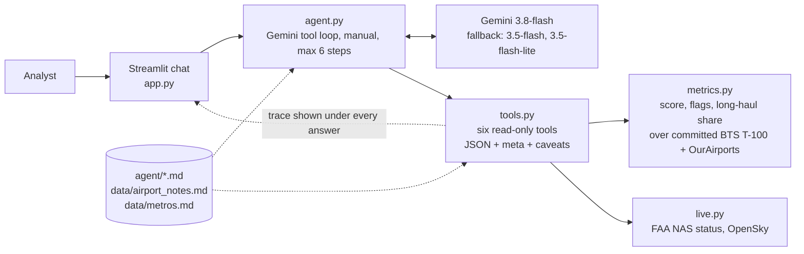

# Airport Investment Intelligence Agent

   

Chat with an analyst assistant that ranks and explains US airports as capacity-expansion investment opportunities.
Every number comes from deterministic code over public aviation data; Gemini only routes a question to one of six
tools and narrates the result, and the full tool trace sits under each answer. The agent itself is defined in
Markdown and executed by a thin Python layer.


## Overview

The "client" is a firm that invests in US airport modernization. Its analysts ask questions such as:

- Which airports in New England are strong candidates for terminal expansion?
- Compare LA and Santa Ana airport congestion levels.
- What is the percentage of long haul flights out of Anchorage airport?
- What is the unmet flight demand in SFO airport and why?

The agent answers with a ranked table, the reasoning behind each number and an explicit list of assumptions and
caveats, in the language the question was asked in.

### Features

- **Deterministic Expansion Opportunity Score (0-100)** for 144 US airports, computed from BTS T-100 traffic and
  OurAirports runway data, with the full component breakdown returned on every call.
- **Six read-only tools**: rank by region or states, airport profile with an unmet-demand signal, side-by-side
  comparison, long-haul share (passenger vs all-cargo), airport search with metro-area disambiguation, and live status.
- **Live overlay, never inside the score**: current FAA ground stops and delays, plus yesterday's departures from
  OpenSky when configured.
- **Curated notes with sources** for facts the data cannot show (SNA's legal passenger cap, SFO's runway spacing,
  DCA's slot and perimeter rules, Anchorage's cargo tech stops), always labeled as such.
- **No silent guesses**: a city with several airports (Los Angeles, Chicago, New York, Washington, the Bay Area)
  gets the list of airports and a question, not a guess.
- **Every answer is auditable**: "Data behind this answer" shows each tool call with its arguments and JSON result,
  and the caption names the model that wrote the text.
- **The agent is Markdown**: the system prompt, tool descriptions, methodology text, caveats and curated knowledge
  live in `agent/*.md` and `data/*.md`, loaded at runtime. Python computes and executes; it holds no prose.
- **Free-tier friendly**: a model fallback chain for Gemini's per-model quotas, and 51 tests that never call the model.

### Architecture



Public data is frozen at build time, the live overlay is fetched at question time, and the model never touches a
number. The methodology, data limits and tradeoffs are in [DESIGN.md](DESIGN.md) (also as [DESIGN.pdf](DESIGN.pdf)).

## Getting started

### Prerequisites

- Python 3.11 or newer (developed on 3.12)
- A free Gemini API key from [Google AI Studio](https://aistudio.google.com/apikey)
- Optional: a free [OpenSky Network](https://opensky-network.org) account for yesterday's departures

### Run locally

```bash
git clone https://github.com/tomerfeldon/Airport-Investment-Intelligence-Agent.git
cd Airport-Investment-Intelligence-Agent
python -m venv .venv
.venv\Scripts\activate            # Windows   |   source .venv/bin/activate on macOS/Linux
pip install -r requirements.txt
copy .env.example .env            # Windows   |   cp .env.example .env on macOS/Linux
```

Put your Gemini key in `.env`, then:

```bash
streamlit run app.py
```

The app opens at http://localhost:8501. Data for 2024-2025 is committed, so nothing is downloaded on first run.

> [!NOTE]
> Gemini's free tier is small and counted per model: on 2026-10-19 `gemini-3.8-flash` allowed 5 requests per
> minute and 20 per day, and one question uses 2-4 requests. The agent falls back through `gemini-3.5-flash` and
> `gemini-3.5-flash-lite` when a model is exhausted (`config.MODELS`), waits once on a per-minute limit, and shows
> which model answered. Production use needs a billed key.

### Configuration

All settings are environment variables read from `.env`:

| Variable | Required | Purpose |
|---|---|---|
| `GEMINI_API_KEY` | yes | Gemini API key |
| `GEMINI_MODEL` | no | put another Gemini model first in the fallback chain |
| `OPENSKY_CLIENT_ID`, `OPENSKY_CLIENT_SECRET` | no | enable yesterday's departures from OpenSky (free API client) |

Everything else that is tunable (data years, universe threshold, score weights, regions) lives in `config.py`.

## Usage

Type a question or click an example in the sidebar. Follow-ups keep the context: "and PVD vs BDL?",
"use 2,500 miles as the long-haul threshold", "compare the whole LA metro".

- **Cities with several airports.** "Compare Los Angeles and Chicago" first returns the airports of each metro
  (LAX, BUR, LGB, ONT, SNA; ORD, MDW) with the primary one marked and asks which to use, or whether to compare all
  of them. The list comes from `data/metros.md`.
- **Data behind this answer.** Expand it under any answer to see every tool call, its arguments and the full result.
- **Languages.** Questions can be asked in Hebrew or any other language; the answer, including section headings,
  follows the question. Airport codes and numbers stay exactly as the tools return them.
- **Voice.** The microphone widget above the chat box records a question; the same model transcribes it.

> [!TIP]
> The four sample questions, with the tool calls the model made and the complete answers, are recorded in
> [docs/sample-answers.md](docs/sample-answers.md).

### Command line

```bash
python agent.py "Compare LA and Santa Ana airport congestion levels."
```

Prints each tool call, the model used and the answer. Useful for checking a prompt or tool change without spending
Streamlit reruns.

## How the score works

```text
score = 100 x sum(weight_i x percentile_rank_i)      percentiles within the universe
```

| Component | Weight | What it captures |
|---|---|---|
| runway pressure (departures of all classes / 365 / runways) | 0.35 | the physical bottleneck |
| passengers | 0.25 | market size |
| load factor (passengers / seats) | 0.25 | demand airlines cannot add seats for |
| passenger growth, latest year vs prior | 0.15 | direction of travel |

The universe is every US airport with at least 500,000 originating passengers in the latest complete T-100 year
(2025): 144 airports, roughly the FAA small-hub threshold. Airports below it get metrics but no score. Missing
components drop out and the remaining weights renormalize, with a caveat. Live signals and curated notes are shown
next to the score and are never part of it.

> [!IMPORTANT]
> The score measures capacity-expansion opportunity, not profitability or ROI. Public data carries no CAPEX, land,
> financing or politics, and every answer says so. The weights are analyst judgment, not fitted to outcomes; each
> result returns the breakdown (component, percentile, weight, contribution) so a reader can disagree with a weight
> and still use the numbers. Details and a worked example: [DESIGN.md, section 2](DESIGN.md#2-scoring-methodology).

## Data sources

| Source | Used for | How it is fetched |
|---|---|---|
| [BTS T-100 Segment (All Carriers)](https://www.transtats.bts.gov/) | departures, seats, passengers, distance and service class per segment, 2024-2025 | `scripts/fetch_data.py` replays the TranStats download form (there is no stable URL); the annual aggregate (93k rows, 1.1 MB) is committed |
| [OurAirports](https://ourairports.com/data/) | airport names, codes, coordinates, runway length and status | public-domain CSVs, same script |
| [FAA NAS Status](https://nasstatus.faa.gov/) | current ground delays, ground stops and closures | public XML at question time, cached 60 s, no key |
| [OpenSky Network](https://opensky-network.org) | yesterday's departures per airport | REST with OAuth2, optional |
| `data/airport_notes.md` | four verified structural facts | hand-written, one source URL per note |

To refresh the committed data (BTS publishes with a 3-6 month lag):

```bash
python scripts/fetch_data.py
```

## Project structure

```text
agent/                  the agent definition, in Markdown, loaded at runtime
  SYSTEM.md             prompt and rules
  tools.md              tool descriptions (applied as docstrings, the schema Gemini sees)
  methodology.md        the score explained; also the sidebar text
  caveats.md            every sentence a tool attaches to a result
  examples.md           sidebar example questions
agentfiles.py           loader for agent/*.md, data/airport_notes.md and data/metros.md
app.py                  Streamlit chat (rendering only)
agent.py                Gemini tool loop with fallback across models
tools.py                the six deterministic tools
metrics.py              per-airport table, score, breakdown, long-haul, unmet-demand flags
live.py                 FAA NAS status, OpenSky
config.py               every tunable
scripts/fetch_data.py   builds data/ from BTS TranStats and OurAirports
data/                   committed extracts, curated notes, metro areas
docs/                   sample answers and screenshot
tests/                  51 tests, no network, model always faked
DESIGN.md, DESIGN.pdf   scoring methodology, tradeoffs, where AI is used
CLAUDE.md               conventions for working on this repository with an AI coding agent
```

## Tests

```bash
pytest
```

Unit tests use a synthetic three-airport dataset whose expected values are worked out by hand, so a scoring bug
cannot hide behind a snapshot. `tests/test_integration_real_data.py` checks the committed data for plausibility
(universe size, SFO load factor, SNA has one commercial runway and LAX four, Anchorage's cargo is more long-haul than
its passenger service, every metro code exists). The Gemini loop, the fallback logic and the UI are tested with a
faked model, so the suite needs no API key and no network.

## Limits and next steps

- The free Gemini tier is for demos; a billed key removes the per-day caps.
- T-100 data lags 3-6 months and is aggregated by year, so seasonal peaks are not visible.
- Runway count is the only public, structured capacity proxy; its blind spots (runway spacing, gates, slots) are
  covered by labeled curated notes rather than hidden heuristics.
- Runway pressure and passenger volume are correlated, so the score leans toward large airports; FAA hub tiers as
  peer groups are the next methodology step. The full list is in [DESIGN.md, section 7](DESIGN.md#7-limitations-and-next-steps).
