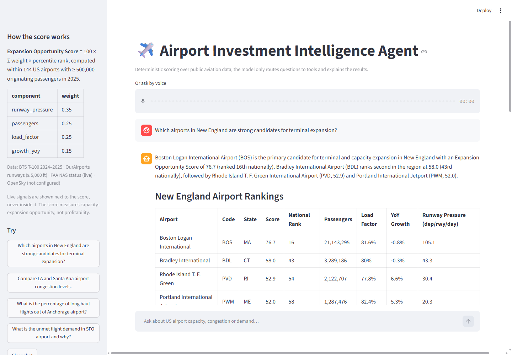

# Airport Investment Intelligence Agent

Chat with an agent that ranks and explains US airports as capacity-expansion investment opportunities.
Deterministic scoring over BTS T-100 traffic and OurAirports runway data, a live FAA (and optional OpenSky)
overlay, and Gemini used only to route questions to tools and explain the results. See `DESIGN.md` for the
methodology and tradeoffs.

## Quick start

    python -m venv .venv
    .venv\Scripts\activate            # Windows   |   source .venv/bin/activate on macOS/Linux
    pip install -r requirements.txt
    copy .env.example .env            # then put your free Gemini key in .env (https://aistudio.google.com/apikey)
    streamlit run app.py

Data for 2024–2025 is committed, so no download is needed. To refresh it (BTS publishes with a lag):

    python scripts/fetch_data.py

Optional live departures from OpenSky: create a free API client at https://opensky-network.org and set
`OPENSKY_CLIENT_ID` / `OPENSKY_CLIENT_SECRET` in `.env`.

Free-tier note: Gemini allows 5 requests per minute for `gemini-3.8-flash`, and one question uses 2–3 requests.
The agent waits and retries on a rate-limit error; if you see one anyway, wait a minute.

## Try asking

- Which airports in New England are strong candidates for terminal expansion?
- Compare LA and Santa Ana airport congestion levels.
- What is the percentage of long haul flights out of Anchorage airport?
- What is the unmet flight demand in SFO airport and why?
- …and follow-ups: "and PVD vs BDL?", "use 2,500 miles as the long-haul threshold".

Under every answer, "Data behind this answer" shows each tool call and its full result. Voice input (microphone
widget above the chat box) is transcribed by the same model.

The full answers to all four questions, as produced on 2026-10-19 with the tool calls the model made, are in
[`docs/sample-answers.md`](docs/sample-answers.md).

## Command line

    python agent.py "Compare LA and Santa Ana airport congestion levels."

## Tests

    pytest

Unit tests use a synthetic three-airport dataset with hand-computed expected values; `tests/test_integration_real_data.py`
checks the committed data for plausibility (universe size, SFO load factor, SNA runway count, ANC cargo vs passenger long-haul).

## Layout

    app.py                 Streamlit chat
    agent.py               Gemini tool loop (manual, with trace)
    tools.py               the six deterministic tools
    metrics.py             per-airport table, score, breakdown, long-haul, unmet-demand
    live.py                FAA NAS status, OpenSky
    config.py              every tunable
    scripts/fetch_data.py  builds data/ from BTS TranStats + OurAirports
    data/                  committed extracts + curated notes
    tests/
    DESIGN.md              scoring methodology, tradeoffs, where AI is used
